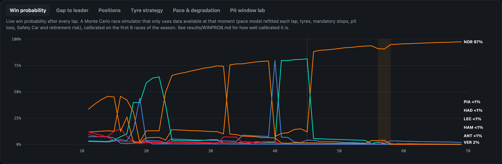
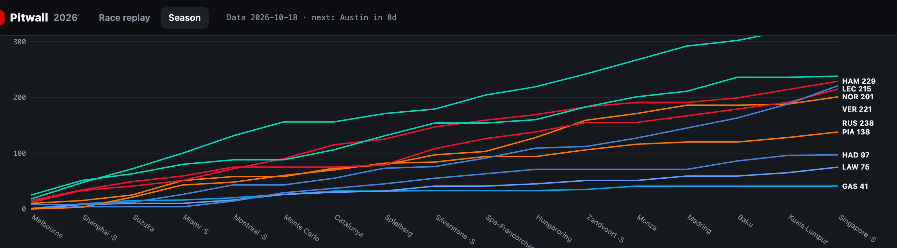
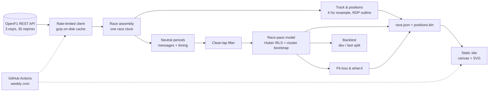
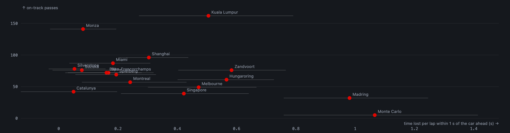
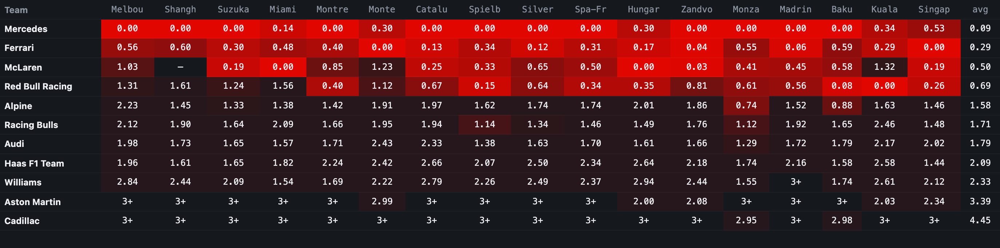

# Pitwall

**Every 2026 Formula 1 race, replayed on the track map, with live timing, tyre strategy and a tyre-degradation
model that is tested on races it has never seen.**

### [▶ Open the live demo](https://emrtunali.github.io/pitwall/)


[](https://github.com/emrtunali/pitwall/actions/workflows/ci.yml)
[](https://github.com/emrtunali/pitwall/actions/workflows/pages.yml)


Pitwall rebuilds each Grand Prix from raw timing data ([OpenF1](https://openf1.org)): 22 cars moving on the
circuit at 4 Hz, a timing board with gaps, tyres, pit stops and a **live win probability**, race-control messages,
Safety Car periods, and analysis charts that follow the replay. Under the hood:
- a robust race-pace model separates driver pace, tyre degradation and fuel burn,
- a Monte Carlo race simulator estimates who will win from what is known at each lap,
- derived metrics that no official feed publishes: how hard it is to follow another car at each circuit,
  where the passes happen, and every team's true pace on equal tyres and fuel.

Every model is evaluated on races it never saw during development, and the site updates itself after every
Grand Prix.

---

## Highlights

| | |
|---|---|
| **Coverage** | All 17 completed 2026 races (Melbourne → Singapore), 19,641 laps, 8.8 M car positions, 1,214 on-track passes |
| **Always current** | A GitHub Action rebuilds the data **every day** and redeploys; a new race appears the morning after it ends |
| **Tyre model, held-out test** | Forecasts the rest of a stint with **0.610 s** mean error, **28 % lower** than the flat-pace baseline (0.844 s), on 9 races not used during development |
| **Win probability, held-out test** | Monte Carlo simulator, log-loss **1.027** vs **1.216** for a learned "running order" model and 2.709 for "the leader wins", on 9 unseen races |
| **Original data** | Dirty-air cost per circuit (from 1.07 s/lap at Monaco to 0.05 s/lap at Silverstone), pass locations, tyre- and fuel-corrected team pace |
| **Championship check** | Points recomputed from race + sprint results match the official standings in **380 / 380** driver-round checks |
| **Runs anywhere** | Double-click `Pitwall.command` (macOS) or `start.bat` (Windows): it downloads the latest races and opens the browser |
| **Tests** | 23 tests on synthetic races with known ground truth, CI on Python 3.11 and 3.13 |

## What you can do

**Race replay.** Play any race at 1× to 64×, scrub the timeline, or jump with ← / →. The timeline shows lap marks,
Safety Car (yellow), VSC (orange) and the focused driver's stops (red). Click a driver on the timing board to
follow them.

**Timing board.** Position, gap to leader or interval (click the header), tyre compound and age, "IN PIT",
retirements and the live win probability, all at the replay time. Press **Overtakes** on the map to see where
each pass was registered, as it happens.



| Gap to leader | Tyre strategy |
|---|---|
|  |  |
| **Pace & degradation** | **Pit window lab** |
|  |  |

**Season view.** Championship progression (validated against the official table), overtaking difficulty per
circuit, true team pace race by race, degradation per compound with 90 % bootstrap intervals, and the measured
pit-stop time loss per circuit.



## Architecture



| Module | Responsibility |
|---|---|
| [`openf1.py`](pitwall/openf1.py) | Rate-limited client (stays under 30 req/min), retries with backoff, gzip-compressed response cache |
| [`race.py`](pitwall/race.py) | Fetches a race and puts every timestamp on one clock (seconds since lap 1). Car positions are fetched in 5-minute windows for all cars at once: about 25 requests per race instead of about 200 |
| [`laps.py`](pitwall/laps.py) | Safety Car / VSC / red-flag windows, pit stops, clean-lap selection |
| [`track.py`](pitwall/track.py) | Resampling to a shared 4 Hz grid with gap detection, track outline from the fastest clean lap (Ramer–Douglas–Peucker) |
| [`model.py`](pitwall/model.py) | Race-pace model, robust fit, identifiability guard, cluster bootstrap |
| [`strategy.py`](pitwall/strategy.py) | Measured pit loss, pit-window what-if curves |
| [`insights.py`](pitwall/insights.py) | Dirty-air cost, on-track overtakes with locations, corrected race pace |
| [`winprob.py`](pitwall/winprob.py), [`winprob_eval.py`](pitwall/winprob_eval.py) | Live win-probability simulator; calibration and held-out evaluation |
| [`serve.py`](pitwall/serve.py) | Local mode: sync new races from the published site, serve, open the browser |
| [`backtest.py`](pitwall/backtest.py), [`evaluate.py`](pitwall/evaluate.py) | Stint forecasting backtest with a chronological development/test split |
| [`build.py`](pitwall/build.py) | Per-race bundles, season index, championship standings and their validation |
| [`site/`](site) | The web app: `app.js` (replay engine, timing board, charts), `style.css`, `index.html` |

## The race-pace model

For every clean green-flag lap:

```
lap_time = pace[driver] + offset[compound] + deg[compound] × tyre_age + fuel × lap_number + ε
```

- **`pace`** is car + driver speed on the reference compound. **`deg`** is the seconds lost per lap of tyre age,
  for each compound. **`fuel`** captures everything that changes with race distance (fuel burn, track rubbering
  in). It is estimated from the data, not assumed.
- **Robust fit.** Traffic, lock-ups and yellow flags only ever make laps slower. Ordinary least squares would
  read those outliers as degradation, so the model uses Huber loss via iteratively re-weighted least squares.
- **Honest uncertainty.** Laps in the same stint are correlated, so the 90 % intervals come from a *stratified
  cluster bootstrap*: whole stints are resampled within each driver.
- **Identifiability guard.** If every car pits on the same lap, tyre age and lap number move together, and
  degradation and fuel effect cannot be separated. The fit checks the rank of the design matrix and refuses
  instead of returning arbitrary numbers. A unit test covers this case.
- **What it publishes.** A compound with fewer than 30 clean laps or fewer than 3 stints gets no degradation
  figure, and a circuit with fewer than 4 green-flag stops gets no pit-loss figure.

**Clean laps** exclude lap 1, in-laps and out-laps, any lap that touches a neutralised period (plus a 10 s margin),
and laps slower than 107 % of the driver's median. That leaves 15,815 of 19,641 laps.

**Pit loss** = (in-lap + out-lap) − the model's prediction for the same two laps raced normally, taking the
median over green-flag stops. It is measured, not looked up.

## Backtest: does the model actually predict anything?

The question a pit wall asks mid-race: *"we've seen 3 laps on these tyres, how fast will the rest of the stint
be?"*

**Protocol**
- For every stint with at least 8 clean laps, observe the first 3 laps and forecast every remaining lap.
- The model is fitted on all *other* stints of that race, so nothing leaks from the stint being forecast.
- **Chronological split.** The first 8 races were used to make the one design choice: how much the first 3
  laps should shift the forecast (shrinkage n₀). The last 9 races were scored once, with that choice frozen.

| Method | Dev MAE (8 races) | **Test MAE (9 races)** |
|---|---|---|
| **Race-pace model** | **0.564 s** | **0.610 s** |
| Same model without tyre degradation | 0.651 s | 0.672 s |
| Flat: rest of stint = mean of first 3 laps | 0.963 s | 0.844 s |
| Driver's median clean lap | 1.233 s | 1.527 s |
| Straight line through first 3 laps | 5.901 s | 4.294 s |

<sub>362 test stints, 6,289 forecast laps. Full tables (per race, per compound, per horizon, shrinkage search):
[`results/BACKTEST.md`](results/BACKTEST.md).</sub>

| Laps ahead (test) | Model | Flat | Gain |
|---|---|---|---|
| 1–5 | 0.592 s | 0.649 s | 9 % |
| 6–10 | 0.578 s | 0.731 s | 21 % |
| 11+ | 0.639 s | 1.033 s | 38 % |

**What the numbers say**
- **The gain grows with the horizon.** Over the next few laps, "same as now" is hard to beat. Further into a
  stint, flat pace drifts and the model's degradation and fuel terms keep up (−38 % error at 11+ laps ahead).
- **The degradation terms carry real signal.** Removing them costs 0.06 s on every test lap (0.672 vs 0.610).
- **Trust the model over three laps.** Development showed that fully re-centring on the first 3 laps is the
  worst option (MAE 0.802 s at n₀ = 0). Three laps of out-lap traffic say less than the rest of the race.
- **It beats the flat baseline on 8 of 9 test races.** The exception is Kuala Lumpur (1.59 s vs 1.14 s), a mixed
  race with two Safety Cars, a long VSC and intermediate tyres. The model has no term for a drying track.

## Data you will not find anywhere else

All three are derived from raw timing. None of them is published by Formula 1 or the data provider.

**Dirty-air cost.** How much slower a car laps while it runs within 1 s of the car ahead, compared with clean air
(more than 3 s), *after* the race-pace model has removed tyres, fuel and driver pace. The interval used is the
median of the gaps recorded during that lap. Confidence intervals come from a cluster bootstrap over stints.

| Hardest to follow | s/lap (90 % CI) | | Easiest to follow | s/lap (90 % CI) |
|---|---|---|---|---|
| Monaco | 1.07 (0.76 – 1.41) | | Catalunya | 0.05 (−0.13 – 0.20) |
| Madrid | 0.98 (0.76 – 1.25) | | Silverstone | 0.05 (−0.03 – 0.16) |
| Zandvoort | 0.58 (0.40 – 0.77) | | Suzuka | 0.08 (−0.02 – 0.18) |
| Hungaroring | 0.57 (0.40 – 0.73) | | Monza | 0.08 (−0.03 – 0.19) |

The ranking matches what drivers say about these tracks, and it lines up with the number of passes: Monaco had
5, Monza 141. This is an *observed* cost, not a causal one, because a car within 1 s may be attacking as well as
being held up.

**On-track overtakes, with locations.** A position swap between two cars counts when it is after lap 1, outside
Safety Car / VSC periods, not within 40 s of either car's pit stop, and the car that lost the place keeps racing
(so retirements are not counted). The location is where the overtaking car was when timing registered the swap.



**True race pace.** Each team's pace term from the model: seconds per lap behind the fastest team on equal
tyres and fuel. Season median: Mercedes 0.00, Ferrari 0.30, McLaren 0.43, Red Bull 0.61, then a gap of a full
second to Alpine (1.62).



## Live win probability: the ML part

At the end of every lap a Monte Carlo simulator answers "who wins from here?" using **only what was known at that
moment**:

1. Refit the race-pace model on the clean laps completed so far. Before the first stops, tyre age and lap number
   are identical for everyone, so the model falls back to their combined trend.
2. Take each car's elapsed time, current compound and tyre age.
3. Simulate the rest of the race 2,000 times with lap-time noise, uncertainty in each driver's pace, a mandatory
   stop for any car that has not yet used two dry compounds, the pit loss measured so far, Safety Cars that bunch
   the field and retirements. The Safety Car and retirement rates come from earlier races only.

Laps are linear in tyre age and lap number, so the sum over a stint has a closed form. Each lap of the
simulation is a handful of NumPy operations over a (simulations × cars) array, so a whole race takes well under a second.

**Calibration.** Three things are tuned on the first 8 races only: the pace-uncertainty inflation κ, a
temperature, and the weight of a learned *running-order* model. The running-order model is a conditional logit
over the current position and the position after pending pit stops, with a race-progress interaction. The last
9 races are scored once.

| Method (test: 9 races, 379 laps) | Log-loss | Brier | Top pick |
|---|---|---|---|
| **Calibrated simulator** | **1.027** | 0.564 | 60.9 % |
| Raw simulator | 1.053 | **0.525** | 56.2 % |
| Running-order model alone | 1.216 | 0.613 | 60.7 % |
| "The leader wins" | 2.709 | 0.766 | 60.9 % |

At 75 % race distance the calibrated simulator's log-loss is 0.84, against 1.04 for the running-order model.
Full tables, checkpoints and the reliability table: [`results/WINPROB.md`](results/WINPROB.md).

**What I learned (and why the README shows all of it).** I iterated on the running-order model three times. Each
version improved the *development* log-loss (0.772 → 0.743 → 0.713), while the *test* log-loss got worse
(0.932 → 0.992 → 1.027). Eight races are a small development set, and the second half of the season was less
predictable than the first (the test races include a wet race and the new semi-street circuit in Madrid). The
reported model is the one the protocol selects on development data. I did not pick it by looking at the test
set. The takeaway is that the simulator carries the transferable signal, and the order-based prior should get
less weight as more races arrive. Visible side effect: probabilities still jump when a leader makes a pit stop,
because the selected mix leans on running order.

## Data quality: what the raw feed got wrong, and how it is handled

Working with raw timing data meant finding its problems before they reached a chart:

| Problem found | Effect if ignored | Fix |
|---|---|---|
| The pit endpoint's `lap_number` is the in-lap at some events and the out-lap at others | Pit loss at Melbourne came out as 7 s (realistic: 20+ s) | Stops are taken from the timing flag `is_pit_out_lap`, which is consistent |
| A red-flag suspension at Monza has no RED message | The Safety Car window ran to the chequered flag; 17 clean laps left, degradation 5 s/lap | Any lap where the field median is ≥ 3× normal is a suspension; an SC never called in ends when the field returns to racing pace |
| A driver ran a whole race on intermediates (Montreal) | That compound is confounded with the driver's pace; the fit is singular | A compound must have ≥ 10 laps, ≥ 2 tyre ages and ≥ 2 drivers to enter the fit |
| Location data has gaps (retirements, telemetry dropouts) | Cars freeze or jump across the infield | Samples more than 3 s from real data are marked missing and the car is hidden |
| The 30 req/min rate limit | A naive fetch takes ~200 requests per race | Fetch all cars per time window and gzip-cache every response (the whole season fits in a 91 MB cache) |

## Run it on your computer

**Easiest:** download or clone the repo and double-click **`Pitwall.command`** (macOS) or **`start.bat`**
(Windows). The first run sets up a Python environment (about a minute). Every run checks the published site for
new races, downloads only what is missing (seconds) and opens the browser. Python 3.11+ is required.

> macOS may block a downloaded script the first time: right-click `Pitwall.command` → **Open** → **Open**.

**From a terminal:**

```bash
git clone https://github.com/emrtunali/pitwall && cd pitwall
python3 -m venv .venv && source .venv/bin/activate
pip install -e ".[dev]"

pitwall serve              # sync new races, start the site, open the browser
pitwall serve --offline    # use what is already downloaded
pitwall serve --rebuild    # rebuild everything yourself from OpenF1 (~1 min per race, cached afterwards)
pitwall evaluate           # rerun both backtests -> results/
```

```bash
pytest -q            # 23 tests
ruff check .
```

Tests run against a **synthetic race with known ground truth** (degradation, fuel effect, driver pace, pit time),
so they check that the model *recovers the truth*, not just that the code runs: robustness to traffic outliers,
bootstrap coverage, identifiability, Safety Car and red-flag detection, resampling and the API cache.

## Deployment

[`pages.yml`](.github/workflows/pages.yml) runs on every push, **every day at 06:00 UTC** and on demand:

- It restores the OpenF1 cache, so only new races are downloaded, then rebuilds all bundles and both backtests
  and publishes `site/` to GitHub Pages.
- A race is picked up once it finished at least 12 hours earlier. Finished-race responses are cached forever, so
  this keeps a half-published race from being frozen in the cache.
- The season calendar itself is never cached, and empty responses are never cached either.
- If one race fails to build, the rest of the site still deploys, and the failure is listed in `index.json`.

The header shows when the data was last updated and how many days remain until the next race. Because the test
split is "every race after the first eight", the backtests grow by one race every weekend.

## Limitations

- **Strategy lab.** The what-if curves price every lap as a racing lap, and traffic, undercuts and Safety Cars
  are not simulated. They show what the tyre model implies, not what would have happened.
- **One linear degradation rate per compound and race.** Cliffs, graining phases and track temperature are not
  modelled. Mixed-weather races are where this shows most (Kuala Lumpur).
- **Win probability.** The simulator ignores track position (it is easier to stay ahead than to pass) and
  undercut effects. The order-based prior makes probabilities jump at pit stops (see above).
- **Approximate pit-lane display.** "IN PIT" on the board is a ±12 s window around the timing-line crossing,
  because the feed's pit timestamps are not consistent between events.
- **Unofficial.** Data comes from OpenF1. This project is not associated with Formula 1.

## License

MIT
