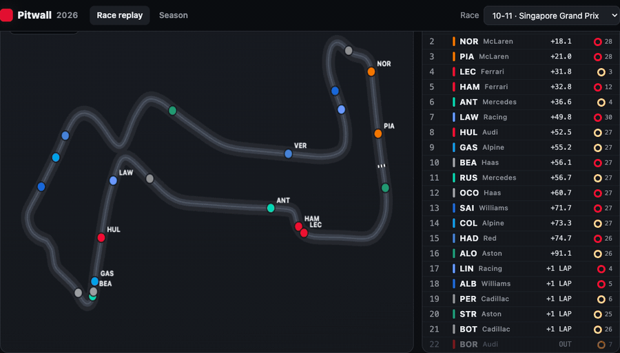
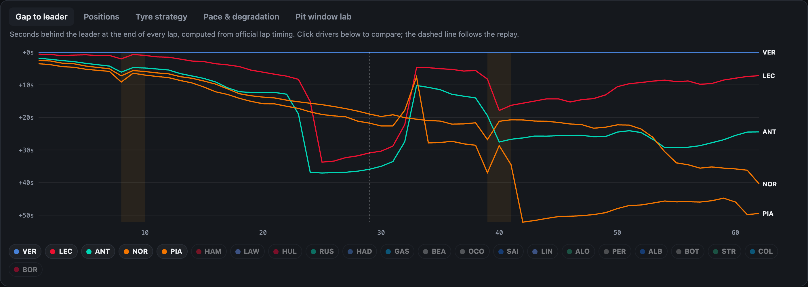
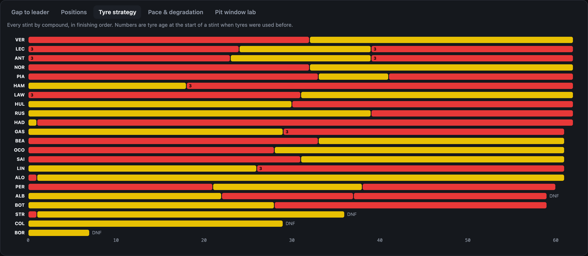
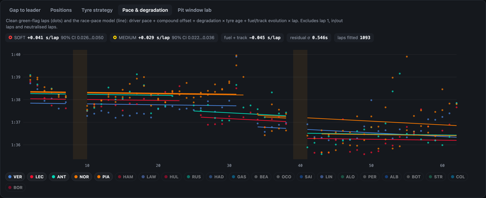
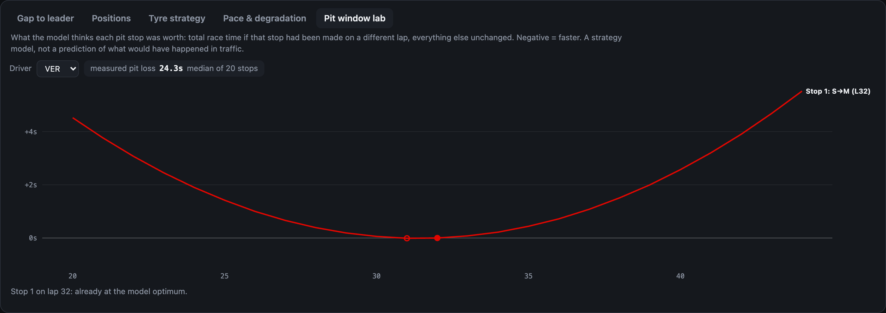
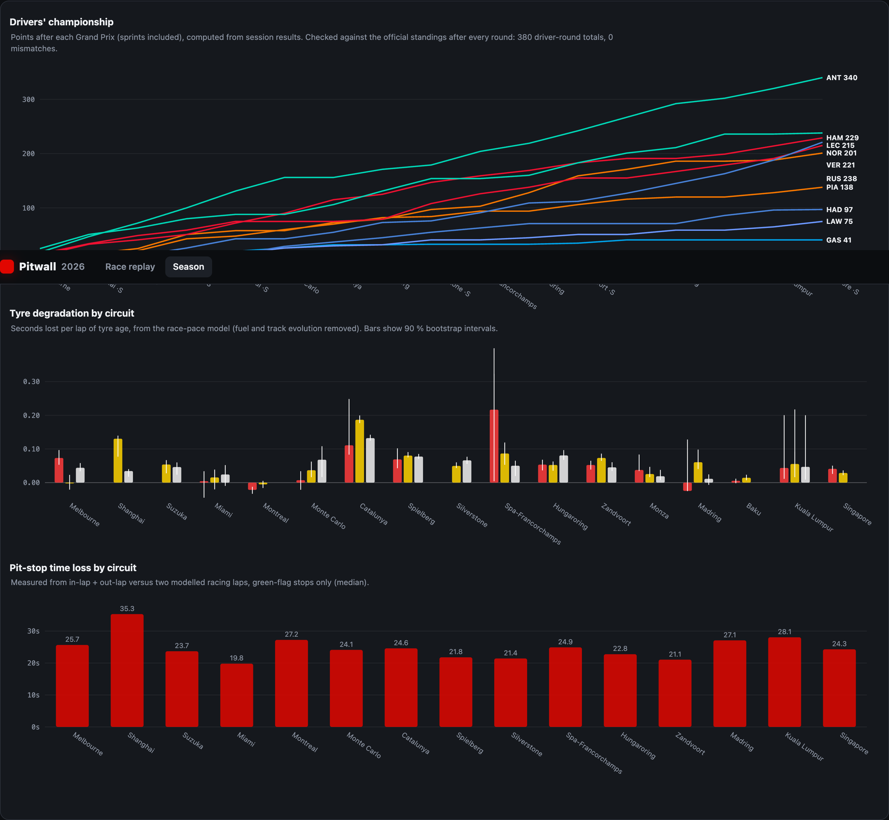
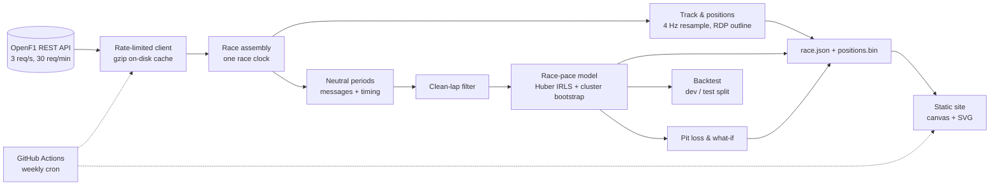

# Pitwall

**Every 2026 Formula 1 race, replayed on the track map, with live timing, tyre strategy and a tyre-degradation
model that is tested on races it has never seen.**

### [▶ Open the live demo](https://emrtunali.github.io/pitwall/)



[](https://github.com/emrtunali/pitwall/actions/workflows/ci.yml)
[](https://github.com/emrtunali/pitwall/actions/workflows/pages.yml)


Pitwall rebuilds each Grand Prix from raw timing data ([OpenF1](https://openf1.org)): 22 cars moving on the
circuit at 4 Hz, a timing board with gaps, tyres and pit stops, race-control messages, Safety Car periods, and
analysis charts that follow the replay. Under the hood a robust race-pace model separates driver pace, tyre
degradation and fuel burn. It is backtested on held-out races and powers a "what if we had pitted on lap X"
strategy lab.

---

## Highlights

| | |
|---|---|
| **Coverage** | All 17 completed 2026 races (Melbourne → Singapore), 19,641 laps, 8.8 M car positions |
| **Stays current** | A scheduled GitHub Action rebuilds the data every Monday and redeploys the site |
| **Tyre model, held-out test** | Forecasts the rest of a stint with **0.610 s** mean error, **28 % lower** than the flat-pace baseline (0.844 s), on 9 races not used during development |
| **Championship check** | Points recomputed from race + sprint results match the official standings in **380 / 380** driver-round checks |
| **Front-end** | Zero dependencies, no build step: canvas replay plus hand-written SVG charts, ~2 MB per race |
| **Tests** | 18 unit tests on a synthetic race with known ground truth, CI on Python 3.11 and 3.13 |

## What you can do

**Race replay.** Play any race at 1× to 64×, scrub the timeline, or jump with ← / →. The timeline shows lap marks,
Safety Car (yellow), VSC (orange) and the focused driver's stops (red). Click a driver on the timing board to
follow them.

**Timing board.** Position, gap to leader or interval (click the header), tyre compound and age, "IN PIT" and
retirements, all at the replay time.

| Gap to leader | Tyre strategy |
|---|---|
|  |  |
| **Pace & degradation** | **Pit window lab** |
|  |  |

**Season view.** Championship progression, degradation per compound at every circuit with 90 % bootstrap
intervals, and the measured pit-stop time loss per circuit.



## Architecture



| Module | Responsibility |
|---|---|
| [`openf1.py`](pitwall/openf1.py) | Rate-limited client (stays under 30 req/min), retries with backoff, gzip-compressed response cache |
| [`race.py`](pitwall/race.py) | Fetches a race and puts every timestamp on one clock (seconds since lap 1). Car positions are fetched in 5-minute windows for all cars at once: about 25 requests per race instead of about 200 |
| [`laps.py`](pitwall/laps.py) | Safety Car / VSC / red-flag windows, pit stops, clean-lap selection |
| [`track.py`](pitwall/track.py) | Resampling to a shared 4 Hz grid with gap detection, track outline from the fastest clean lap (Ramer–Douglas–Peucker) |
| [`model.py`](pitwall/model.py) | Race-pace model, robust fit, identifiability guard, cluster bootstrap |
| [`strategy.py`](pitwall/strategy.py) | Measured pit loss, pit-window what-if curves |
| [`backtest.py`](pitwall/backtest.py), [`evaluate.py`](pitwall/evaluate.py) | Stint forecasting backtest with a chronological development/test split |
| [`build.py`](pitwall/build.py) | Per-race bundles, season index, championship standings and their validation |
| [`site/`](site) | The web app: `app.js` (replay engine, timing board, charts), `style.css`, `index.html` |

## The race-pace model

For every clean green-flag lap:

```
lap_time = pace[driver] + offset[compound] + deg[compound] × tyre_age + fuel × lap_number + ε
```

- **`pace`** is car + driver speed on the reference compound. **`deg`** is the seconds lost per lap of tyre age,
  for each compound. **`fuel`** captures everything that changes with race distance (fuel burn, track rubbering
  in). It is estimated from the data, not assumed.
- **Robust fit.** Traffic, lock-ups and yellow flags only ever make laps slower. Ordinary least squares would
  read those outliers as degradation, so the model uses Huber loss via iteratively re-weighted least squares.
- **Honest uncertainty.** Laps in the same stint are correlated, so the 90 % intervals come from a *stratified
  cluster bootstrap*: whole stints are resampled within each driver.
- **Identifiability guard.** If every car pits on the same lap, tyre age and lap number move together, and
  degradation and fuel effect cannot be separated. The fit checks the rank of the design matrix and refuses
  instead of returning arbitrary numbers. A unit test covers this case.
- **What it publishes.** A compound with fewer than 30 clean laps or fewer than 3 stints gets no degradation
  figure, and a circuit with fewer than 4 green-flag stops gets no pit-loss figure.

**Clean laps** exclude lap 1, in-laps and out-laps, any lap that touches a neutralised period (plus a 10 s margin),
and laps slower than 107 % of the driver's median. That leaves 15,815 of 19,641 laps.

**Pit loss** = (in-lap + out-lap) − the model's prediction for the same two laps raced normally, taking the
median over green-flag stops. It is measured, not looked up.

## Backtest: does the model actually predict anything?

The question a pit wall asks mid-race: *"we've seen 3 laps on these tyres, how fast will the rest of the stint
be?"*

**Protocol**
- For every stint with at least 8 clean laps, observe the first 3 laps and forecast every remaining lap.
- The model is fitted on all *other* stints of that race, so nothing leaks from the stint being forecast.
- **Chronological split.** The first 8 races were used to make the one design choice: how much the first 3
  laps should shift the forecast (shrinkage n₀). The last 9 races were scored once, with that choice frozen.

| Method | Dev MAE (8 races) | **Test MAE (9 races)** |
|---|---|---|
| **Race-pace model** | **0.564 s** | **0.610 s** |
| Same model without tyre degradation | 0.651 s | 0.672 s |
| Flat: rest of stint = mean of first 3 laps | 0.963 s | 0.844 s |
| Driver's median clean lap | 1.233 s | 1.527 s |
| Straight line through first 3 laps | 5.901 s | 4.294 s |

<sub>362 test stints, 6,289 forecast laps. Full tables (per race, per compound, per horizon, shrinkage search):
[`results/BACKTEST.md`](results/BACKTEST.md).</sub>

| Laps ahead (test) | Model | Flat | Gain |
|---|---|---|---|
| 1–5 | 0.592 s | 0.649 s | 9 % |
| 6–10 | 0.578 s | 0.731 s | 21 % |
| 11+ | 0.639 s | 1.033 s | 38 % |

**What the numbers say**
- **The gain grows with the horizon.** Over the next few laps, "same as now" is hard to beat. Further into a
  stint, flat pace drifts and the model's degradation and fuel terms keep up (−38 % error at 11+ laps ahead).
- **The degradation terms carry real signal.** Removing them costs 0.06 s on every test lap (0.672 vs 0.610).
- **Trust the model over three laps.** Development showed that fully re-centring on the first 3 laps is the
  worst option (MAE 0.802 s at n₀ = 0). Three laps of out-lap traffic say less than the rest of the race.
- **It beats the flat baseline on 8 of 9 test races.** The exception is Kuala Lumpur (1.59 s vs 1.14 s), a mixed
  race with two Safety Cars, a long VSC and intermediate tyres. The model has no term for a drying track.

## Data quality: what the raw feed got wrong, and how it is handled

Working with raw timing data meant finding its problems before they reached a chart:

| Problem found | Effect if ignored | Fix |
|---|---|---|
| The pit endpoint's `lap_number` is the in-lap at some events and the out-lap at others | Pit loss at Melbourne came out as 7 s (realistic: 20+ s) | Stops are taken from the timing flag `is_pit_out_lap`, which is consistent |
| A red-flag suspension at Monza has no RED message | The Safety Car window ran to the chequered flag; 17 clean laps left, degradation 5 s/lap | Any lap where the field median is ≥ 3× normal is a suspension; an SC never called in ends when the field returns to racing pace |
| A driver ran a whole race on intermediates (Montreal) | That compound is confounded with the driver's pace; the fit is singular | A compound must have ≥ 10 laps, ≥ 2 tyre ages and ≥ 2 drivers to enter the fit |
| Location data has gaps (retirements, telemetry dropouts) | Cars freeze or jump across the infield | Samples more than 3 s from real data are marked missing and the car is hidden |
| The 30 req/min rate limit | A naive fetch takes ~200 requests per race | Fetch all cars per time window and gzip-cache every response (the whole season fits in a 91 MB cache) |

## Run it locally

```bash
git clone https://github.com/emrtunali/pitwall && cd pitwall
python -m venv .venv && source .venv/bin/activate
pip install -e ".[dev]"

pitwall build        # fetch every completed race (~1 min per race the first time, cached afterwards)
pitwall evaluate     # season backtest -> results/BACKTEST.md
python -m http.server 8000 --directory site    # open http://localhost:8000
```

```bash
pytest -q            # 18 tests
ruff check .
```

Tests run against a **synthetic race with known ground truth** (degradation, fuel effect, driver pace, pit time),
so they check that the model *recovers the truth*, not just that the code runs: robustness to traffic outliers,
bootstrap coverage, identifiability, Safety Car and red-flag detection, resampling and the API cache.

## Deployment

[`pages.yml`](.github/workflows/pages.yml) runs on every push, every Monday at 06:00 UTC and on demand. It
restores the OpenF1 cache, so only new races are downloaded, rebuilds all bundles and the backtest, then
publishes `site/` to GitHub Pages. The site picks up each new Grand Prix without anyone touching it.

## Limitations

- **Strategy lab.** The what-if curves price every lap as a racing lap, and traffic, undercuts and Safety Cars
  are not simulated. They show what the tyre model implies, not what would have happened.
- **One linear degradation rate per compound and race.** Cliffs, graining phases and track temperature are not
  modelled. Mixed-weather races are where this shows most (Kuala Lumpur).
- **Approximate pit-lane display.** "IN PIT" on the board is a ±12 s window around the timing-line crossing,
  because the feed's pit timestamps are not consistent between events.
- **Unofficial.** Data comes from OpenF1. This project is not associated with Formula 1.

## License

MIT
